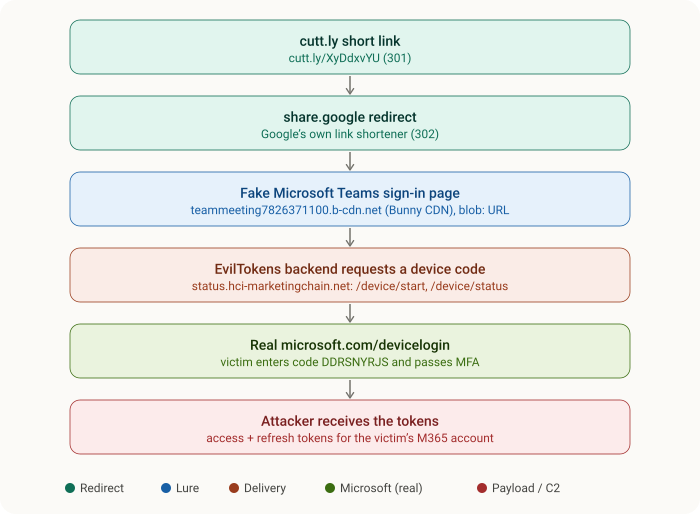
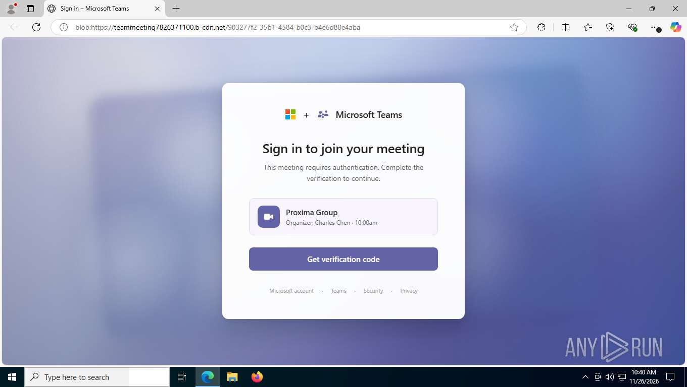
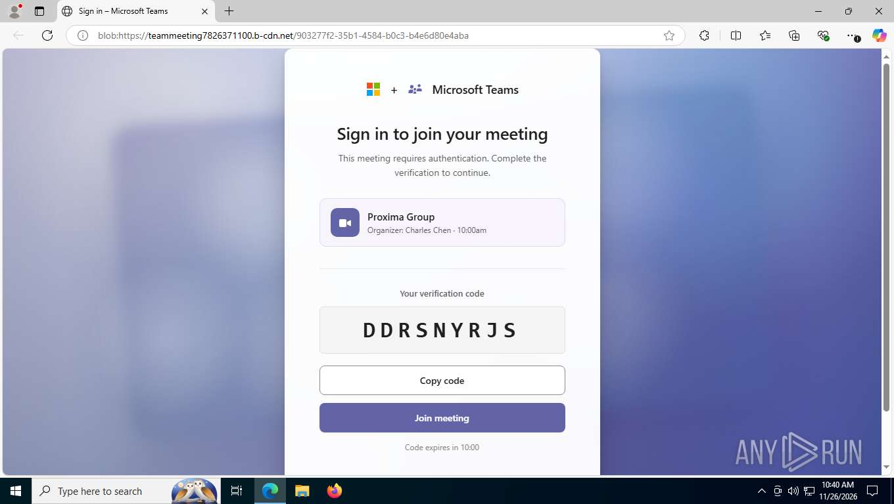
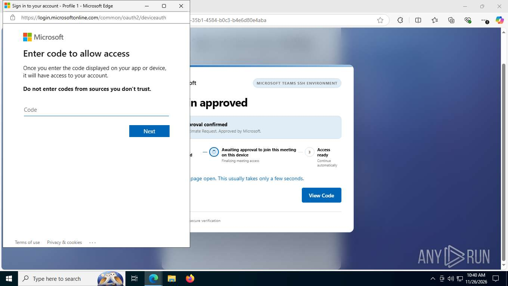
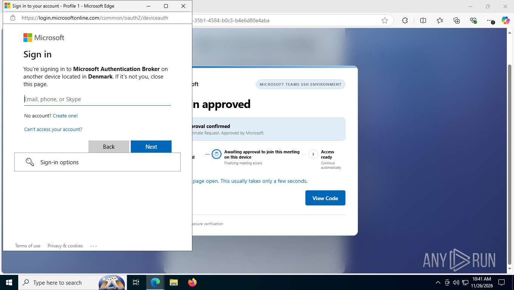
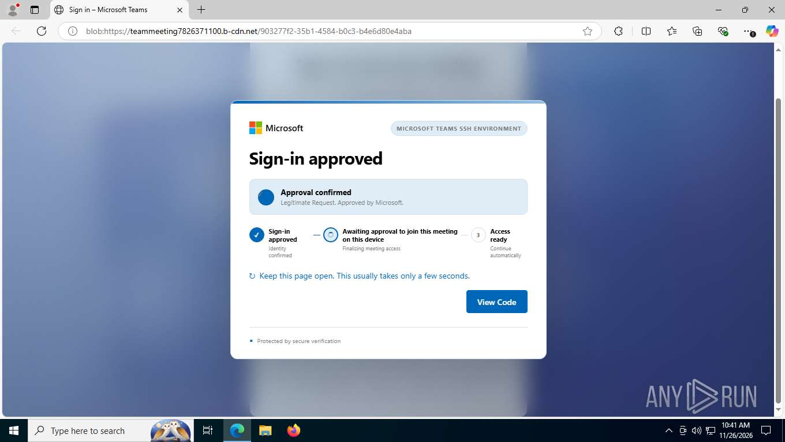
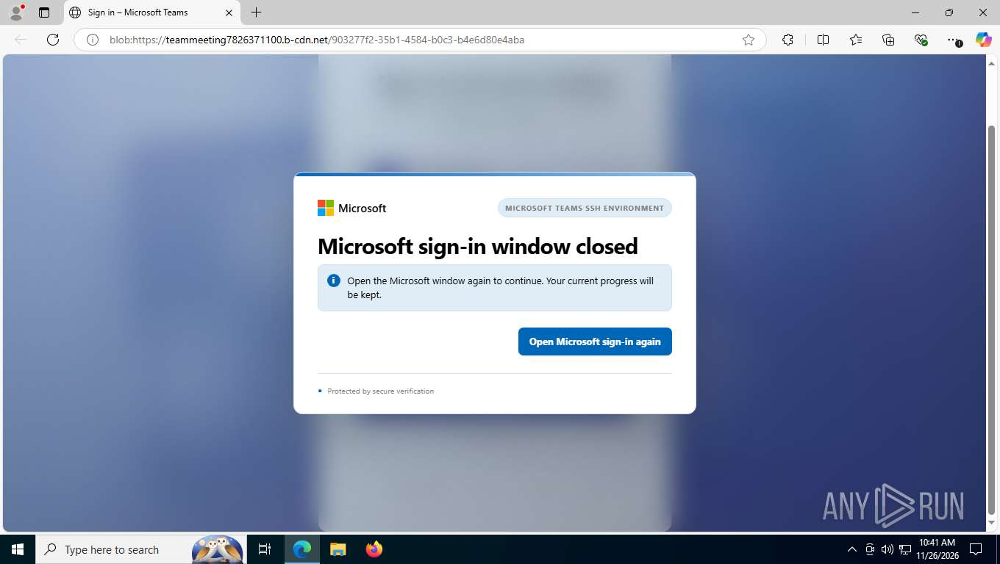

# Fake Teams Meeting Steals Microsoft 365 Accounts with Device Code Phishing (EvilTokens)

**TL;DR:** A link that passes through `cutt[.]ly` and Google's own `share.google` shortener lands on a fake **Microsoft Teams "Sign in to join your meeting"** page hosted on Bunny CDN. The page hands the victim a "verification code" and opens the **real** `microsoft.com/devicelogin` page. When the victim types the code and signs in, they are not joining a meeting. They are approving a sign-in for the attacker's own session, and Microsoft gives the attacker valid tokens for the victim's Microsoft 365 account. No password is typed into a fake site, every Microsoft page involved is genuine, and **MFA does not stop it**, because the victim completes MFA on the attacker's behalf. ANY.RUN attributes the kit to **EvilTokens**.

> ⚠️ **Joining a Teams meeting never requires you to enter a code at `microsoft.com/devicelogin`.** If a meeting link asks you to, close it.

---

## Summary

| | |
|---|---|
| **Lure** | Fake Microsoft Teams meeting join page, "Proxima Group", organiser "Charles Chen" |
| **Technique** | OAuth 2.0 device authorization grant phishing (device code phishing) |
| **Phishing kit** | EvilTokens (ANY.RUN tracker) |
| **Redirect chain** | `cutt[.]ly` → `share[.]google` → `teammeeting7826371100.b-cdn[.]net` |
| **Kit backend** | `status.hci-marketingchain[.]net` (Cloudflare) |
| **Abused Microsoft client** | Microsoft Authentication Broker |
| **Goal** | Access and refresh tokens for the victim's Microsoft 365 / Entra ID account |
| **Sandbox report** | [ANY.RUN task 1a30c88f](https://app.any.run/tasks/1a30c88f-7d08-49e3-b09d-abe62ab316eb/) (Windows 10 x64, Edge, 2026-11-26) |

---

## How device code phishing works

The device code flow exists so that devices without a proper keyboard or browser, such as smart TVs, conference room systems and command-line tools, can sign in. The device shows a short code, and you enter it on another device at `microsoft.com/devicelogin`. Microsoft then gives the **device that asked for the code** a set of tokens for your account.

EvilTokens simply puts the attacker in the role of "the device":

```
 Attacker backend                       Victim                        Microsoft
 ────────────────                       ──────                        ─────────
 1. Requests a device code  ───────────────────────────────────────▶  login.microsoftonline.com
    for "Microsoft Authentication Broker"                  ◀──────── returns code DDRSNYRJS
 2. Shows the code on a fake
    Teams page  ──────────────────────▶ "Sign in to join your meeting"
                                        3. Opens microsoft.com/devicelogin
                                           (the REAL site), enters the code,
                                           signs in and passes MFA  ─────▶ "Approve sign-in"
 4. Keeps polling "has the victim
    entered it yet?"  ◀──────────────────────────────────────────────  issues access +
                                                                       refresh tokens
 5. Attacker now holds the victim's
    session: mail, Teams, OneDrive, SharePoint…
```

Because the victim really is on `login.microsoftonline.com`, every usual piece of advice fails here: check the URL, look for the padlock, use a password manager, enable MFA. All of them pass.

---

## Attack chain



*Attack chain: two shorteners lead to the fake Teams page, the EvilTokens backend requests a real device code, and the victim enters it at Microsoft's genuine sign-in page. No malware file is involved, so there are no file hashes.*

<details>
<summary>Text version of the chain</summary>

```
hxxps://cutt[.]ly/XyDdxvYU                       (URL shortener)
        │ 301
        ▼
hxxps://share[.]google/GAyWzmfkNq59VZtAM         (Google's own share-link shortener)
        │ 302 → www.google.com/share.google?q=…
        ▼
hxxps://teammeeting7826371100.b-cdn[.]net/index%20(12).html     (Bunny CDN, 185.111.111.155)
        │ page re-renders itself from a blob: URL
        ▼
blob:hxxps://teammeeting7826371100.b-cdn[.]net/903277f2-…       "Sign in – Microsoft Teams"
        │ fetch()
        ▼
hxxps://status.hci-marketingchain[.]net/static-export/api/      (EvilTokens backend, Cloudflare)
   ├─ GET  /visitor/country
   ├─ POST /device/start          (X-Antibot-Token header)  → device code issued
   └─ GET  /device/status/744958  (polled every few hundred ms)
        │
        ▼
hxxps://microsoft.com/devicelogin → login.microsoftonline.com/common/oauth2/deviceauth   (legitimate)
```

</details>

### 1. Delivery: two shorteners, one of them Google

The sandbox run starts from the `cutt[.]ly` link, so the exact delivery channel (email, Teams chat, SMS) isn't visible. The redirect chain is the interesting part. The second hop is `share[.]google`, Google's own link shortener, which redirects through `www.google.com`. Email gateways and users both tend to trust a Google domain, and the shortener hides the real destination until the click. The same `share.google` trick is turning up in other campaigns submitted to ANY.RUN this week, including ones that deliver infostealers.

### 2. The fake Teams page

The landing page sits on a throwaway Bunny CDN subdomain, `teammeeting7826371100.b-cdn[.]net`. It immediately re-renders itself from a `blob:` URL, so the address bar shows `blob:https://…` and the phishing HTML never sits at a fixed URL that scanners can fetch again later.

The page uses Microsoft and Teams branding, says *"This meeting requires authentication. Complete the verification to continue."* and shows a fake meeting card for **"Proxima Group"**, organised by **"Charles Chen"** at 10:00am. Its only button is **"Get verification code"**.


*Figure 1: The lure. A fake Teams "Sign in to join your meeting" page on `teammeeting7826371100.b-cdn[.]net`. Source: [ANY.RUN](https://app.any.run/tasks/1a30c88f-7d08-49e3-b09d-abe62ab316eb/).*

### 3. The attacker requests a real Microsoft device code

When the victim clicks the button, the page calls the kit's backend at `status.hci-marketingchain[.]net`:

1. `GET /static-export/api/visitor/country` looks up where the visitor is, which kits typically use to filter out sandboxes and unwanted regions.
2. `POST /static-export/api/device/start` is sent with an `X-Antibot-Token` header. The backend asks Microsoft for a fresh device code and returns it to the page.
3. `GET /static-export/api/device/status/744958` is then polled over and over. The backend is asking Microsoft "has the user entered the code yet?", and the moment the answer is yes, it collects the tokens.

The page displays the code, **`DDRSNYRJS`**, with a **"Copy code"** button, a **"Join meeting"** button and a countdown, *"Code expires in 10:00"*. The countdown adds urgency and matches the real lifetime of a Microsoft device code.


*Figure 2: The device code issued by Microsoft to the attacker's backend, presented as a "meeting verification code". Note the `blob:` URL in the address bar. Source: [ANY.RUN](https://app.any.run/tasks/1a30c88f-7d08-49e3-b09d-abe62ab316eb/).*

### 4. The victim is sent to the real Microsoft page

"Join meeting" opens a small pop-up window at the genuine `microsoft.com/devicelogin`, which redirects to `login.microsoftonline.com/common/oauth2/deviceauth`. Microsoft's own page asks the victim to *"Enter code to allow access"* and even warns *"Do not enter codes from sources you don't trust."* Victims who just copied the code from what they believe is a Teams page usually don't connect that warning to their situation.


*Figure 3: The real Microsoft code-entry page, opened by the phishing page in a pop-up. Source: [ANY.RUN](https://app.any.run/tasks/1a30c88f-7d08-49e3-b09d-abe62ab316eb/).*

After the code is entered, Microsoft shows the sign-in prompt. This screen gives the attack away, if the victim reads it:

> *You're signing in to **Microsoft Authentication Broker** on another device located in **Denmark**. If it's not you, close this page.*

The "other device" is the attacker's backend. The client it requested tokens for is **Microsoft Authentication Broker**, a first-party Microsoft app. Attackers favour this client in device code phishing because its tokens can be used to go further than a single app, such as registering a device in the victim's tenant and obtaining longer-lived credentials. (Denmark is where Microsoft located the backend's request. The backend itself is hidden behind Cloudflare.)


*Figure 4: Microsoft's genuine sign-in prompt. It names the client, Microsoft Authentication Broker, and says the requesting device is in Denmark. Source: [ANY.RUN](https://app.any.run/tasks/1a30c88f-7d08-49e3-b09d-abe62ab316eb/).*

### 5. Keeping the victim calm, and keeping them going

Behind the pop-up, the fake page switches to a **"Sign-in approved"** screen with a badge reading *"Approval confirmed: Legitimate Request. Approved by Microsoft."*, a progress tracker (*"Awaiting approval to join this meeting on this device"*) and *"Keep this page open. This usually takes only a few seconds."* A label reading **"MICROSOFT TEAMS SSH ENVIRONMENT"** adds technical-sounding noise. All of this keeps the victim waiting quietly while the backend collects the tokens.


*Figure 5: The fake "Sign-in approved" holding screen. Nothing here comes from Microsoft. Source: [ANY.RUN](https://app.any.run/tasks/1a30c88f-7d08-49e3-b09d-abe62ab316eb/).*

If the victim closes the Microsoft pop-up without finishing, the kit notices and nags: **"Microsoft sign-in window closed"**, with an **"Open Microsoft sign-in again"** button.


*Figure 6: The kit detects a closed pop-up and pushes the victim to reopen the real sign-in page. Source: [ANY.RUN](https://app.any.run/tasks/1a30c88f-7d08-49e3-b09d-abe62ab316eb/).*

---

## What the attacker gets

Once the victim signs in, the attacker holds a valid **access token and refresh token** for the victim's account, issued by Microsoft. With these they can typically:

- read and send mail, search the mailbox and set up inbox rules (for business email compromise and invoice fraud);
- read Teams chats and send messages as the victim to spread the same lure internally;
- access OneDrive and SharePoint files;
- keep access long after the phishing page is gone, because refresh tokens renew themselves, and **changing the password alone may not end the attacker's session**;
- potentially register a device in the tenant through the Authentication Broker client, giving them an even more persistent foothold.

---

## Indicators of Compromise

All indicators are from the ANY.RUN run on 2026-11-26. Domains are defanged.

### Network

| Type | Indicator | Notes |
|---|---|---|
| URL | `hxxps://cutt[.]ly/XyDdxvYU` | First-stage shortener |
| URL | `hxxps://share[.]google/GAyWzmfkNq59VZtAM` | Google share-link redirect |
| Domain | `teammeeting7826371100.b-cdn[.]net` | Phishing page (Bunny CDN) |
| IP | `185.111.111[.]155` | Bunny CDN edge serving the page (shared, don't block on its own) |
| URL | `hxxps://teammeeting7826371100.b-cdn[.]net/index%20(12).html` | Landing page |
| Domain | `status.hci-marketingchain[.]net` | EvilTokens backend |
| Domain | `hci-marketingchain[.]net` | Parent domain of the backend |
| IP | `172.67.177[.]180`, `104.21.17[.]168` | Cloudflare front for the backend (shared, don't block on their own) |
| URL path | `/static-export/api/visitor/country` | Visitor geolocation check |
| URL path | `/static-export/api/device/start` | Device code request (with `X-Antibot-Token` header) |
| URL path | `/static-export/api/device/status/<id>` | Token polling |

### Lure content

| Indicator | Value |
|---|---|
| Page title | `Sign in – Microsoft Teams` |
| Headline | `Sign in to join your meeting` |
| Fake meeting | `Proxima Group`, organiser `Charles Chen` |
| Follow-up screens | `Sign-in approved`, `Microsoft sign-in window closed` |
| Page label | `MICROSOFT TEAMS SSH ENVIRONMENT` |

### Identity (Entra ID) signals

| Signal | Value |
|---|---|
| Authentication protocol | Device code (`deviceCode`) |
| Client application | Microsoft Authentication Broker |
| Pattern | The victim's interactive sign-in comes from their usual location, while the token-redeeming request comes from an unfamiliar IP or country (here, Denmark) |

---

## Detection ideas

### Entra ID sign-in logs (Microsoft Sentinel / KQL)

Look for device code sign-ins, which most users never legitimately perform:

```kql
SigninLogs
| where TimeGenerated > ago(14d)
| where AuthenticationProtocol =~ "deviceCode"
| project TimeGenerated, UserPrincipalName, AppDisplayName, AppId,
          IPAddress, Location = tostring(LocationDetails.countryOrRegion),
          ResultType, UserAgent
| order by TimeGenerated desc
```

Device code sign-ins to **Microsoft Authentication Broker** from users who don't administer devices deserve close attention:

```kql
SigninLogs
| where AuthenticationProtocol =~ "deviceCode"
| where AppDisplayName has "Authentication Broker"
| summarize Count = count(), IPs = make_set(IPAddress), Countries = make_set(tostring(LocationDetails.countryOrRegion))
    by UserPrincipalName
```

After a hit, check `AuditLogs` for new device registrations (`Register device`, `Add registered owner to device`) and new inbox rules for the same user.

### Web proxy / DNS (Sigma-style)

```yaml
title: EvilTokens Device Code Phishing Backend Requests
status: experimental
logsource:
  category: proxy
detection:
  selection_path:
    c-uri|contains:
      - '/static-export/api/device/start'
      - '/static-export/api/device/status/'
  selection_domain:
    cs-host|endswith: 'hci-marketingchain.net'
  condition: selection_path or selection_domain
level: high
```

```yaml
title: Teams-Themed Bunny CDN Subdomain Followed by Device Login
status: experimental
logsource:
  category: proxy
detection:
  lure:
    cs-host|re: '^teammeeting[0-9]+\.b-cdn\.net$'
  condition: lure
level: medium
```

A broader hunting idea: a user visits a non-Microsoft page and then `microsoft.com/devicelogin` within a minute or two. Legitimate device code use almost never starts from a link on a random website.
