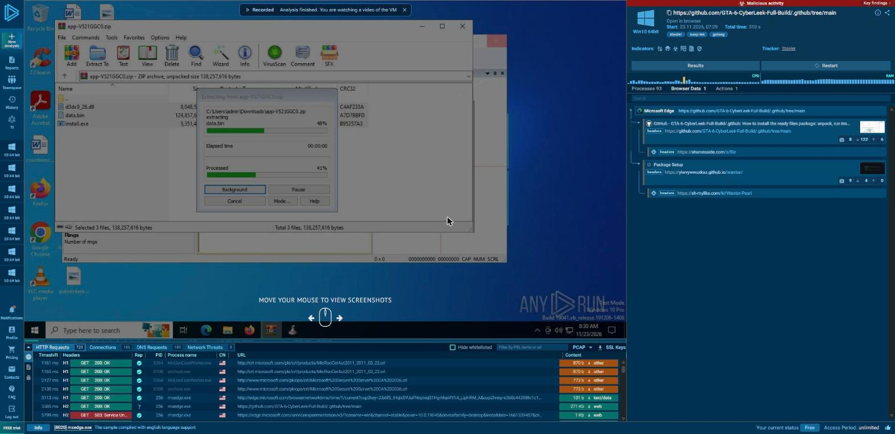
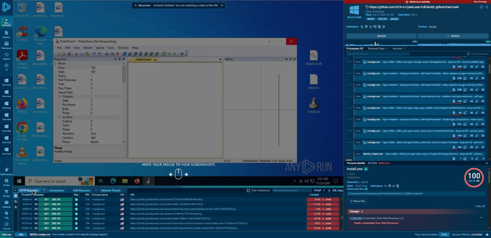

# Fake "GTA 6 Full Build" on GitHub Side-Loads a Possible Infostealer

**TL;DR:** A GitHub organisation page advertising a 209 GB "GTA 6 CyberLeek Full Build" sends visitors through three redirects, one of them a GitHub Pages site, to a ZIP file. The ZIP contains a legitimate copy of the 3D modelling program **PotterDraw** renamed `install.exe`, and a malicious `d3dx9_26.dll` placed next to it. When `install.exe` runs, it loads the malicious DLL, a **possible infostealer** written in Go (38 of 67 antivirus engines detect it, several as a stealer; no specific family is named). In the sandbox it copied the browser's cookie, autofill and history files, uploaded about 650 KB to a server behind Cloudflare, and dropped a second executable that starts with Windows.

> ⚠️ **There is no PC download of GTA 6.** Any "full build", "installer" or "launcher" for it is malware or a scam.

---

## Summary

| | |
|---|---|
| **Lure** | `github.com/GTA-6-CyberLeek-Full-Build` (organisation profile README) |
| **Redirect chain** | `shanxisaide[.]com` → `yiwvywwuxkaz.github[.]io` → `sh-mylike[.]com` |
| **Download** | `app-V521GGC0.zip` |
| **Loader** | `install.exe`: legitimate PotterDraw 1.0.8.0 (0/68 on VirusTotal, first seen 2021) |
| **Payload** | `d3dx9_26.dll`: possible infostealer (Go), 38/67 on VirusTotal; family not identified |
| **Technique** | DLL side-loading (assessed) |
| **C2** | `vibhe0[.]tattoo`, `buggergame[.]onl` (both behind Cloudflare) |
| **Persistence** | Dropped `RNyZi8Ng5asPa9DPaim9s.exe`, run from the Startup folder |
| **Sandbox report** | [ANY.RUN task 8b1af66c](https://app.any.run/tasks/8b1af66c-f658-4c40-a083-f48488d83e86/) (Windows 10 x64, 2026-11-23, verdict: malicious) |

---

## Infection chain

```
github.com/GTA-6-CyberLeek-Full-Build/.github        lure page
  └─ hxxps://shanxisaide[.]com/s/file                 redirector
       └─ hxxps://yiwvywwuxkaz.github[.]io/warrior/      "Package Setup" (GitHub Pages)
            └─ hxxps://sh-mylike[.]com/kl/Warrior-Pearl     download
                 └─ app-V521GGC0.zip                 opened in WinRAR (138 MB unpacked)
                      ├─ install.exe                 legitimate PotterDraw (renamed)
                      ├─ d3dx9_26.dll                malicious DLL, side-loaded
                      └─ data.bin                    ~125 MB
                           install.exe + d3dx9_26.dll
                             ├─ chrome.exe (×10)
                             └─ RNyZi8Ng5asPa9DPaim9s.exe → Startup folder
```

### 1. The lure

The organisation's only repository is `.github`, so its README is shown as the organisation's profile page. Its description reads:

> How to install the ready files package: unpack, run install.exe as admin, pick a short path, let the stub stream and verify all 209 GB. Every game file lands now; the executable follows on November 23.

The page shows a "DOWNLOAD INSTALL.EXE" badge and badges reading "BY CYBERLEEK", "ONLINE INSTALLER", "BUILD FULL", "EXE NOV 23" and "PAYLOAD 209 GB". Claiming a small "online installer" for a 209 GB game explains away why the download is so small.

### 2. Redirects

The download badge leads off GitHub to `shanxisaide[.]com/s/file`. From there the browser is passed to a GitHub Pages site with a random name, `yiwvywwuxkaz.github[.]io/warrior/`, and then to `sh-mylike[.]com/kl/Warrior-Pearl`, which serves the archive. Routing through GitHub Pages puts a trusted domain in the middle of the chain.

The Pages site is a page titled "Package Setup" that hides its destination in Base64 and forwards the visitor with JavaScript:

```javascript
const targetUrl = atob(targetUrlBase64)   // aHR0cHM6Ly9zaC1teWxpa2UuY29tL2tsL1dhcnJpb3ItUGVhcmw=
...
window.location.replace(destination)      // hxxps://sh-mylike[.]com/kl/Warrior-Pearl
```

It is published from the GitHub organisation `yiwvywwuxkaz`, created on 31 October 2026. The organisation holds two Pages repositories, `warrior` (created 15 Nov) and `huang` (created 14 Nov). Each contains only a README reading "GET YOUR DOWNLOAD HERE" and the same `index.html`, and both decode to the same `sh-mylike[.]com` address. The commit history of `warrior` is three commits in one minute: "Initial commit", "Upload project files" and "Add GitHub Pages download link".

### 3. The archive

`app-V521GGC0.zip` is saved to Downloads and opened in WinRAR. It holds three files that unpack to 138,227,616 bytes:

| File | Size | MD5 | VirusTotal |
|---|---|---|---|
| `install.exe` | 5.35 MB | `8a3871a90593aa3d4e57b33cefe9f070` | 0/68, first seen 24 May 2021 |
| `d3dx9_26.dll` | 8.05 MB | `d284a70a3ec8e18f637feebc66919db4` | **38/67**, first seen 22 Nov 2026 |
| `data.bin` | ~124.9 MB | not recorded | not checked |

The large `data.bin` makes the package look like real game data and pushes the unpacked size past the upload limits of many scanners.


*Figure 1: WinRAR extracting `app-V521GGC0.zip` (left) and ANY.RUN's browser panel recording the lure page, `shanxisaide[.]com/s/file`, the "Package Setup" page on `yiwvywwuxkaz.github[.]io/warrior/` and `sh-mylike[.]com/kl/Warrior-Pearl` (right).*

`install.exe` is run from inside WinRAR's temporary folder (`%TEMP%\Rar$EXa6672.26880\install.exe`). It was started twice during the run.

### 4. Side-loading

`install.exe` is not malicious on its own. Its file properties are those of **PotterDraw 1.0.8.0**, an open-source pottery modelling program, and VirusTotal has seen this exact file since 2021 under names such as `PotterDraw.exe` and `setup.exe`, with no detections.

PotterDraw uses Direct3D, and Windows looks for a DLL in the program's own folder before the system folders. Shipping a malicious `d3dx9_26.dll` beside the program means the trusted executable loads the attacker's code. We assess this as **DLL side-loading** based on three points: the clean, five-year-old executable; the detected DLL with a Direct3D file name in the same folder; and the malicious behaviour appearing inside the `install.exe` process. We did not confirm the load in the module list.

The PotterDraw window opens and then stops responding, so the victim sees a program that appears to have crashed.


*Figure 2: The "PotterDraw (Not Responding)" window on the sandbox desktop, with ANY.RUN's process details for `install.exe` (score 100/100).*

### 5. The possible stealer

`d3dx9_26.dll` is detected by 38 of 67 engines on VirusTotal. Several name it a stealer, but only generically:

| Engine | Detection |
|---|---|
| Malwarebytes | `Spyware.Stealer.GO` |
| ESET-NOD32 | `WinGo/Kryptik.AHZ Trojan` |
| Kaspersky | `Trojan.Win64.Goblin.j` |
| AliCloud | `Trojan[stealer]:Win/Convagent.gyf` |
| Antiy-AVL | `Trojan[PSW]/Win32.Convagent` |
| Microsoft | `Trojan:Win32/Ravartar!rfn` |

VirusTotal's consensus label is `trojan.yogi/convagent` with the categories trojan and spyware. No engine names a known stealer family.

In the sandbox, the `install.exe` process, running the DLL's code, did the following.

**Observed:**

- copied the Edge profile's `History`, `Web Data` (autofill entries, addresses and saved payment cards) and `Network\Cookies` files. The saved-password store, `Login Data`, does not appear in the list of files it touched, although ANY.RUN still flags "Steals credentials from Web Browsers";
- launched Chrome with about ten child processes, a common way for stealers to read cookies through the browser itself;
- listed installed software through the registry.

**Flagged by ANY.RUN as possible (heuristic):**

- access to crypto wallet browser extensions (multiple wallet extension IDs found in the sample);
- access to password managers, 2FA apps, VPN clients, messengers, notes, FTP clients, email clients and cloud storage data;
- screenshot capability (YARA match).

ANY.RUN maps this to ATT&CK T1555.003 (Credentials from Web Browsers), T1552.001 (Credentials in Files), T1217 (Browser Information Discovery) and T1518 (Software Discovery).

### 6. Exfiltration

The `install.exe` process opened two HTTPS connections:

| Domain | IP | Data sent |
|---|---|---|
| `vibhe0[.]tattoo` | 172.67.140.245 (Cloudflare) | 656 KB |
| `buggergame[.]onl` | 172.67.177.239 (Cloudflare) | 4 KB |

The traffic is encrypted, so its contents are not visible. A 656 KB upload to a domain registered four days earlier, right after the browser files were copied, is consistent with exfiltration. Both domains sit behind Cloudflare, so the IP addresses are shared and should not be blocked on their own.

### 7. Persistence

Fifteen seconds after starting, the `install.exe` process wrote a 953 KB executable, `RNyZi8Ng5asPa9DPaim9s.exe` (MD5 `7107adefdc607e8e3a6dfe7102d0e07f`), to `%TEMP%`. That file then created a file in the **Startup folder** and was launched from there, so it runs at every logon. A second randomly named executable, `aeygaRFR0yePLcqVmTmLmTess3NcDR.exe`, also ran.

---

## Status (28 November 2026)

| Component | Status |
|---|---|
| Lure organisation `GTA-6-CyberLeek-Full-Build` | Removed by GitHub |
| GitHub Pages redirectors `yiwvywwuxkaz/warrior` and `yiwvywwuxkaz/huang` | **Live**, still forwarding to `sh-mylike[.]com` |
| `sh-mylike[.]com` | Resolves (2.26.172.85) |
| `vibhe0[.]tattoo`, `buggergame[.]onl` | No DNS address returned |

Removing the lure page does not break the chain. Any other lure that links to `shanxisaide[.]com` or directly to the Pages sites still leads to the download.

---

## Indicators of Compromise

### Network

| Indicator | Role |
|---|---|
| `github[.]com/GTA-6-CyberLeek-Full-Build` | Lure |
| `hxxps://shanxisaide[.]com/s/file` | Redirector |
| `hxxps://yiwvywwuxkaz.github[.]io/warrior/` | Redirector (GitHub Pages) |
| `hxxps://yiwvywwuxkaz.github[.]io/huang/` | Redirector (GitHub Pages, same target) |
| `github[.]com/yiwvywwuxkaz` | GitHub organisation hosting both Pages sites |
| `hxxps://sh-mylike[.]com/kl/Warrior-Pearl` | Download |
| `vibhe0[.]tattoo` | C2 / exfiltration |
| `buggergame[.]onl` | C2 |

### Files

| File | Hash | Verdict |
|---|---|---|
| `d3dx9_26.dll` (8.05 MB) | SHA-256 `a9011124354bae6560dfeedd67d661fd1f8aef82ba46c8140e8589b0eb6cb367`<br>MD5 `d284a70a3ec8e18f637feebc66919db4` | **Malicious** (possible infostealer) |
| `RNyZi8Ng5asPa9DPaim9s.exe` (953 KB) | MD5 `7107adefdc607e8e3a6dfe7102d0e07f` | Malicious (dropped, persists) |
| `install.exe` (5.35 MB) | SHA-256 `496d1c75257ec33af07d2095084736d71837f5191615ca6b166ca12097e30863`<br>MD5 `8a3871a90593aa3d4e57b33cefe9f070` | **Legitimate** PotterDraw; abused as loader. Do not block by hash alone |
| `app-V521GGC0.zip` | not recorded | Archive name; likely generated per download |

### Host

- PotterDraw (`install.exe`) running from `%TEMP%\Rar$EX*\` or `Downloads` with `d3dx9_26.dll` in the same folder
- That process reading `%LOCALAPPDATA%\Microsoft\Edge\User Data\Default\Network\Cookies`, `Web Data` and `History`
- That process starting `chrome.exe`
- A randomly named executable in `%TEMP%` that writes to the Startup folder

---

## Detection ideas

### d3dx9_26.dll loaded from outside System32 (KQL)

```kql
DeviceImageLoadEvents
| where Timestamp > ago(14d)
| where FileName =~ "d3dx9_26.dll"
| where FolderPath !startswith @"C:\Windows\"
| project Timestamp, DeviceName, FolderPath, SHA256, InitiatingProcessFileName,
          InitiatingProcessFolderPath, InitiatingProcessVersionInfoProductName
```

### PotterDraw running from an archive or Downloads

```kql
DeviceProcessEvents
| where Timestamp > ago(14d)
| where ProcessVersionInfoProductName =~ "PotterDraw" or ProcessVersionInfoFileDescription =~ "PotterDraw"
| where FolderPath has_any (@"\AppData\Local\Temp\", @"\Downloads\")
| project Timestamp, DeviceName, FileName, FolderPath, SHA256
```

### Process from an archive reading browser credential stores

```kql
DeviceFileEvents
| where Timestamp > ago(14d)
| where InitiatingProcessFolderPath matches regex @"(?i)\\AppData\\Local\\Temp\\Rar\$EX"
| where FolderPath has_any (@"\User Data\Default\Network\Cookies", @"\User Data\Default\Web Data", @"\User Data\Default\Login Data")
| project Timestamp, DeviceName, InitiatingProcessFileName, InitiatingProcessFolderPath, FolderPath
```

### Startup-folder persistence from Temp

```kql
DeviceFileEvents
| where Timestamp > ago(14d)
| where ActionType == "FileCreated"
| where FolderPath has @"\Start Menu\Programs\Startup\"
| where InitiatingProcessFolderPath has @"\AppData\Local\Temp\"
| project Timestamp, DeviceName, FileName, FolderPath, InitiatingProcessFileName, InitiatingProcessFolderPath
```

### DNS and web proxy

Alert on lookups of `vibhe0[.]tattoo`, `buggergame[.]onl`, `shanxisaide[.]com` and `sh-mylike[.]com`, and block `yiwvywwuxkaz.github[.]io`.
